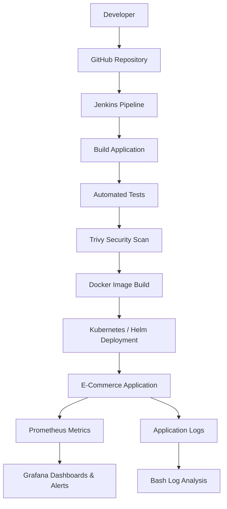

<div align="center">

# 🛒 AI-Powered E-Commerce DevOps Platform

### 🚀 Cloud-Native Delivery • CI/CD Automation • Monitoring • DevSecOps

A hands-on DevOps project demonstrating automated application delivery,
containerization, infrastructure automation, Kubernetes deployment,
security scanning, and observability.

<p>
  
  
  
  
  
  
  
</p>

**Built as a practical Cloud, DevOps & DevSecOps learning project**

</div>

---

## 📌 Table of Contents

- [Overview](#-overview)
- [Key Features](#-key-features)
- [Technology Stack](#-technology-stack)
- [Architecture](#-architecture)
- [CI/CD Workflow](#-cicd-workflow)
- [Project Structure](#-project-structure)
- [Application Endpoints](#-application-endpoints)
- [Monitoring & Alerting](#-monitoring--alerting)
- [Security](#-security)
- [Run Locally](#-run-locally)
- [Infrastructure Automation](#-infrastructure-automation)
- [Current Status](#-current-status)
- [Future Improvements](#-future-improvements)

---

## 🎯 Overview

This project demonstrates an end-to-end DevOps workflow for a
containerized e-commerce application.

It brings together CI/CD automation, automated testing, container image
security scanning, Infrastructure as Code, configuration management,
Kubernetes orchestration, and application monitoring.

The goal is to understand how application code moves from a Git repository
through an automated delivery pipeline to a monitored deployment.

## ✨ Key Features

- 🔄 **CI/CD:** Jenkins pipeline integrated with GitHub.
- 🧪 **Automated Testing:** Python application tests using pytest.
- 🐳 **Containerization:** Docker image builds and Docker Compose.
- 🛡️ **Security Scanning:** Trivy image vulnerability scanning.
- 🏗️ **Infrastructure as Code:** Terraform configuration.
- ⚙️ **Configuration Management:** Ansible playbook.
- ☸️ **Orchestration:** Kubernetes deployments, services, ConfigMaps and Secrets.
- 📦 **Package Management:** Helm chart validation and deployment.
- 📊 **Observability:** Prometheus metrics and Grafana dashboards.
- 🚨 **Alerting:** Grafana application-health alert rule.
- 📜 **Log Analysis:** Bash script for summarizing application logs.

## 🧰 Technology Stack

| Category | Technologies |
|---|---|
| Application | Python, Flask |
| Version Control | Git, GitHub |
| CI/CD | Jenkins |
| Containers | Docker, Docker Compose |
| Security | Trivy |
| Infrastructure as Code | Terraform |
| Configuration Management | Ansible |
| Orchestration | Kubernetes, Minikube |
| Deployment Packaging | Helm |
| Metrics | Prometheus |
| Visualization & Alerts | Grafana |
| Automation | Bash, Python |
| Cloud | AWS — planned/extension |

## 🏗️ Architecture



*The diagram represents the intended workflow; cloud deployment and any
unfinished integrations remain separate from the verified local setup.*

## 🔄 CI/CD Workflow

1. **Checkout:** Jenkins retrieves the source code from GitHub.
2. **Build:** The pipeline prepares the application and Docker image.
3. **Test:** Automated Python tests validate application behavior.
4. **Security Scan:** Trivy checks the container image for vulnerabilities.
5. **Containerization:** Docker packages the application.
6. **Deployment:** Kubernetes and Helm manage application deployments.
7. **Monitoring:** Prometheus collects application metrics.
8. **Alerting & Logs:** Grafana evaluates alerts, while a Bash script
   summarizes application log entries.

## 📁 Project Structure

```text
final-ecommerce-devops/
├── ai/                       # Incident-analysis tooling
├── ansible/                  # Ansible playbooks
├── application/
│   ├── app/                  # Flask application
│   ├── tests/                # Automated tests
│   └── requirements.txt
├── docs/                     # Project documentation
├── helm/
│   └── ecommerce/            # Helm chart
├── kubernetes/
│   ├── monitoring/            # Prometheus configuration
│   ├── deployment.yaml
│   ├── service.yaml
│   ├── configmap.yaml
│   └── secret.yaml
├── logging/                  # Logging-related configuration
├── monitoring/               # Monitoring resources
├── reports/                  # Security scan reports
├── scripts/
│   └── analyze-logs.sh       # Application log summary
├── security/                 # Security-related resources
├── terraform/                # Terraform configuration
├── Dockerfile
├── docker-compose.yml
├── Jenkinsfile
└── README.md
```

*Directory contents may evolve as the project progresses.*

## 🌐 Application Endpoints

| Endpoint | Purpose |
|---|---|
| `/` | Application home |
| `/health` | Application health check |
| `/products` | Product listing |
| `/metrics` | Prometheus application metric |

The `/metrics` endpoint exposes the custom `ecommerce_app_up` metric.

## 📊 Monitoring & Alerting

Prometheus collects application metrics, and Grafana visualizes the
application health signal.

Current monitoring work includes:

- Prometheus scrape configuration.
- Custom application-health metric.
- Grafana application status dashboard.
- Grafana alert rule for application availability.
- Kubernetes application log collection for local analysis.

## 🛡️ Security

Security practices explored in this project include:

- Trivy container image vulnerability scanning.
- Non-root application container.
- Docker container hardening.
- Kubernetes Secret usage for demo configuration.
- Exclusion of Terraform state files from Git.

**Note:** The Kubernetes Secret contains a demonstration value, not a
production credential. Real deployments require proper secret management.

## 🚀 Run Locally

### Prerequisites

- Git
- Python 3.12
- Docker and Docker Compose
- Optional: Kubernetes/Minikube, Helm, Terraform, Ansible

### Clone the repository

```bash
git clone https://github.com/HarshitMali930/final-ecommerce-devops.git
cd final-ecommerce-devops
```

### Start the application with Docker Compose

```bash
docker compose up --build -d
```

Check the container status:

```bash
docker compose ps
```

Use the configured application port to open the application and test its
health and product endpoints. Check `docker-compose.yml` for the current
port mapping.

Stop the containers:

```bash
docker compose down
```

## 🏗️ Infrastructure Automation

### Terraform

Terraform is used to define Docker-based infrastructure.

```bash
cd terraform
terraform init
terraform validate
terraform plan
```

Review the plan before applying any infrastructure changes.

### Ansible

Ansible playbooks are maintained under the `ansible/` directory for
configuration and environment checks.

### Kubernetes & Helm

Kubernetes manifests are maintained in `kubernetes/`, and the application
Helm chart is maintained in `helm/ecommerce/`.

Validate the chart with:

```bash
helm lint helm/ecommerce
```

## 📍 Current Status

| Component | Status |
|---|---|
| Flask application & tests | Implemented |
| Jenkins CI/CD pipeline | Implemented and tested |
| Docker & Compose | Implemented |
| Trivy image scanning | Implemented |
| Terraform & Ansible | Implemented and tested locally |
| Kubernetes deployment | Running locally on Minikube |
| Helm chart | Validated and deployed locally |
| Prometheus & Grafana | Application metrics and dashboard configured |
| Grafana alert rule | Configured |
| Bash log analysis | Implemented |
| Centralized ELK logging | Pending verification |
| Actual AI model integration | Pending implementation |
| AWS cloud deployment | Future extension |

## 🔮 Future Improvements

- Deploy the platform to AWS.
- Publish images to a container registry.
- Improve centralized logging and log search.
- Integrate an actual AI model for incident analysis.
- Add automated rollback and deployment strategies.
- Strengthen secrets management and vulnerability remediation.

---

<div align="center">

### 💻 Learning by Building

**Cloud • DevOps • DevSecOps • Kubernetes • Observability**

Made for hands-on learning and practical engineering experience.

</div>
